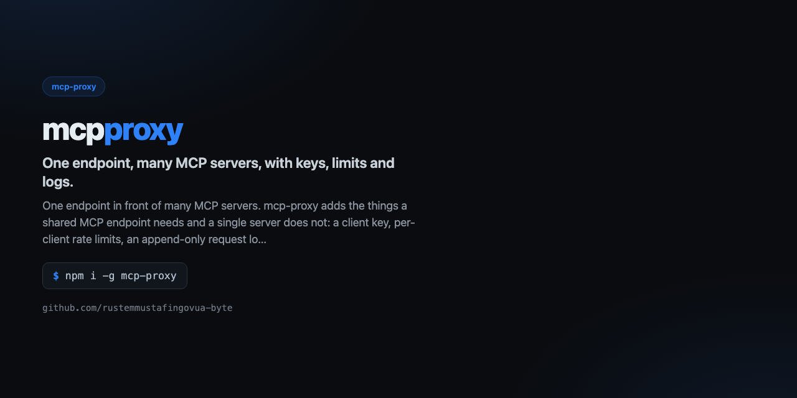

<div align="center">



# mcp-proxy

**One endpoint, many MCP servers, with keys, limits and logs.**

[](https://github.com/rustemmustafingovua-byte/mcp-proxy/actions/workflows/ci.yml)
[](https://www.npmjs.com/package/mcp-proxy)
[](./LICENSE)
[](https://nodejs.org)
[](https://base.org)

[**Docs**](https://rustemmustafingovua-byte.github.io/mcp-proxy/) · [Issues](https://github.com/rustemmustafingovua-byte/mcp-proxy/issues) · [Discussions](https://github.com/rustemmustafingovua-byte/mcp-proxy/discussions)

</div>

---

One endpoint in front of many MCP servers. mcp-proxy adds the things a shared MCP endpoint needs and a single server does not: a client key, per-client rate limits, an append-only request log, replay of past calls, and routing by server name.

## Install

```bash
npm i -g mcp-proxy
```

<details>
<summary>Без npm-логина — из tarball релиза</summary>

```bash
npm i -g https://github.com/rustemmustafingovua-byte/mcp-proxy/releases/download/v0.1.0/mcp-proxy-0.1.0.tgz
```

</details>
## What it does

| | |
|---|---|
| **A single client key** | one Bearer token for every backend |
| **Per-client rate limits** | sliding window, Retry-After on the 429 |
| **Append-only request log** | who called what, how long it took, what failed |
| **Replay** | re-run a recorded call with /replay/<id> |


## Usage

```bash
mcp-proxy --servers servers.json --key $MCP_PROXY_KEY --port 8790
```

## CLI

```
mcp-proxy — One endpoint, many MCP servers, with keys, limits and logs.

USAGE
  mcp-proxy --servers servers.json --key $MCP_PROXY_KEY --port 8790

COMMANDS / OPTIONS
  --servers <file>  JSON map of server name -> {url} or {command}
  --key <bearer>    require this client key (default: $MCP_PROXY_KEY)
  --port <n>        port to listen on (default 8790)
  --rpm <n>         per-client request limit (default 60)

Endpoints:
  GET  /health                 status and stats
  GET  /logs?n=20              recent calls
  POST /replay/<id>            replay a recorded call
  POST /?server=<name>         proxy a request to one backend

MIT · https://github.com/rustemmustafingovua-byte
```

## Part of a portfolio

| Project | What it does |
|---|---|
| [`opencode-free-stack`](https://github.com/rustemmustafingovua-byte/opencode-free-stack) | route to free models, fall back automatically |
| [`free-web-mcp`](https://github.com/rustemmustafingovua-byte/free-web-mcp) | web search for agents, zero credits |
| [`agent-x402`](https://github.com/rustemmustafingovua-byte/agent-x402) | pay per API call in USDC with a spend policy |

## Donate

MIT, forever. USDC on Base:

```
0x8aC6a229f254980CCd3Dd35CF5E1B7c08880B40E
```

## License

MIT © rustemmustafingovua-byte
